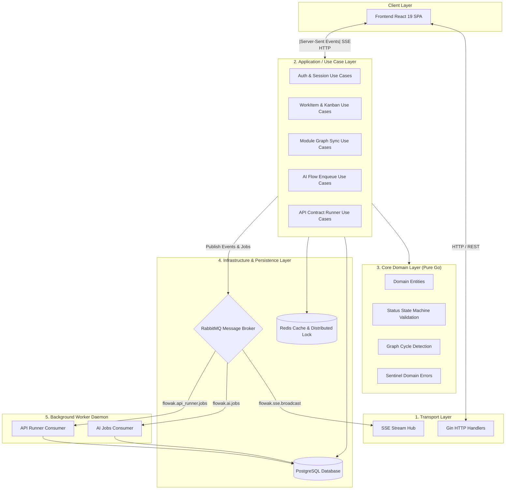
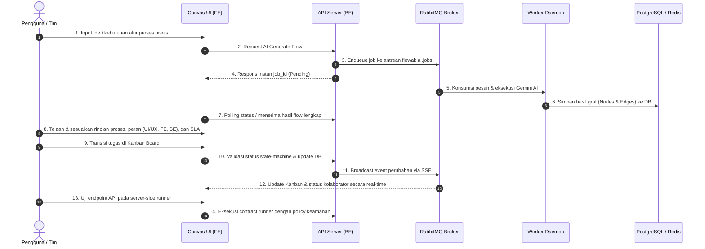

# Flowak 🌊

**Flowak** (*Flow to Action*) adalah platform SaaS kolaboratif berbasis *traceability-native* yang dirancang untuk memodelkan proses bisnis, menyusun spesifikasi teknis lintas peran, mengelola tiket pekerjaan (*Work Items*), serta menguji kontrak API secara terkontrol.

Flowak memadukan kanvas diagram interaktif dengan otomatisasi cerdas berbasis AI advisory, antrean pesan asinkron, dan sistem *caching* berperforma tinggi untuk memastikan koordinasi proyek perangkat lunak berjalan sinkron dari tahap analisis kebutuhan hingga eksekusi teknis.

---

## 🚀 Tech Stack

Flowak dibangun di atas fondasi teknologi modern dengan pemisahan tanggung jawab yang tegas:

### 1. Frontend
* **Core**: [React 19](https://react.dev/) & [TypeScript](https://www.typescriptlang.org/)
* **Build Tool**: [Vite](https://vite.dev/) (dengan proxy API internal untuk pengembangan)
* **Styling**: [Tailwind CSS v4](https://tailwindcss.com/)
* **State Management**: [Zustand](https://github.com/pmndrs/zustand)
* **Motion & Animasi**: [Motion](https://motion.dev/)
* **Ikon**: [Lucide React](https://lucide.dev/)

### 2. Backend
* **Runtime**: [Go (Golang)](https://go.dev/) v1.21+
* **Web Framework**: [Gin-Gonic](https://gin-gonic.com/)
* **Arsitektur**: Clean Architecture (Hexagonal / Ports & Adapters) dengan pola **1 File = 1 Fungsi** (*Single-Function per File*)
* **Otentikasi & Keamanan**: JWT (*JSON Web Token*) dengan Argon2/Bcrypt & Redis Session Blacklisting

### 3. Data & Infrastruktur
* **Primary Database**: [PostgreSQL](https://www.postgresql.org/) (skema ternormalisasi, multi-tenant RBAC, & audit log)
* **In-Memory Cache & Lock**: [Redis](https://redis.io/) (Hot Graph Cache, Distributed Lock Redlock, dan JWT Blacklist)
* **Message Broker & Event-Driven**: [RabbitMQ](https://www.rabbitmq.com/) (Topic Exchange `flowak.events`, antrean pekerjaan asinkron, dan SSE event broadcast)
* **AI Provider**: Google Gemini AI API (*Advisory only* untuk asistensi alur kerja dan audit desain sistem)

---

## 🏛️ Arsitektur Sistem

Backend Flowak menerapkan prinsip **Clean Architecture** yang terbagi dalam beberapa lapisan modular:

### Karakteristik Arsitektur Utama:
1. **Pemisahan Server & Worker**: Tugas komputasi berat (AI generation dan eksekusi cURL API target runner) tidak memblokir HTTP worker, melainkan didelegasikan ke antrean RabbitMQ dan diproses oleh daemon worker independen.
2. **Synchronous Fallback**: Sistem dilengkapi mode fallback otomatis; jika antrean RabbitMQ atau worker tidak aktif, sistem tetap dapat merespons permintaan secara sinkron tanpa galat.
3. **Optimistic Locking & Concurrency Safety**: Perubahan kanvas graf dan transisi status Kanban dilindungi dengan *row versioning* dan *distributed lock* Redis.
4. **Pola 1 File = 1 Fungsi**: Menjamin kemudahan pemeliharaan (*maintainability*), navigasi kode yang intuitif, serta mencegah terjadinya *merge conflict*.

---

## 🔄 Alur Aplikasi (*Application Workflow*)

1. **Pemodelan Alur Kerja (Workflow Modeling)**: Pengguna mendesain alur bisnis interaktif di kanvas visual atau meminta asisten AI merancang draf langkah proses (nodes) beserta alirannya (edges).
2. **Spesifikasi Multidisiplin**: Setiap langkah proses diperinci ke dalam dokumen analisis (aktor, input, proses, output, aturan bisnis, SLA) serta peran teknis (UI/UX, Frontend, Backend).
3. **Pelacakan Kanban Real-Time**: Langkah kerja dipetakan menjadi tiket *work items* di papan Kanban. Setiap perpindahan status divalidasi oleh *state machine* domain dan disiarkan lintas pengguna via Server-Sent Events (SSE).
4. **Eksekusi Kontrak API Aman**: Pengembang dapat menguji kontrak endpoint langsung dari kanvas dengan kebijakan isolasi host target, pencatatan durasi, serta redaksi rahasia/token.

---

## 📖 Panduan Menjalankan Aplikasi

Petunjuk instalasi, konfigurasi, dan cara menjalankan masing-masing komponen aplikasi telah dipisahkan ke dalam direktori masing-masing:

* 👉 **Panduan Backend**: Silakan baca [`backend/README.md`](backend/README.md) untuk cara menjalankan server HTTP Go, Redis, RabbitMQ, dan worker daemon.
* 👉 **Panduan Frontend**: Silakan baca [`frontend/README.md`](frontend/README.md) untuk cara memasang dependensi dan menjalankan development server React Vite.
